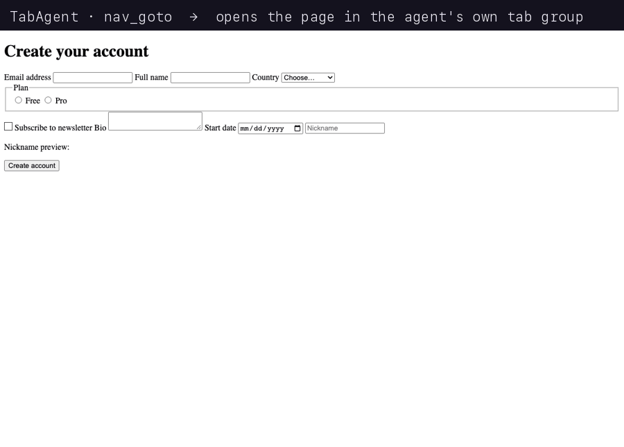

# TabAgent




**Let any AI agent drive your real Chrome.** TabAgent is an open-source Chrome extension plus a
small local bridge that exposes your browser to Claude Code, Codex, Cursor, and any MCP or HTTP
client. Agents can navigate, read pages, pull structured data, fill forms, upload and download
files, and inspect network and console activity. They do it with your existing sign-ins, under
permissions you control.

> Status: **pre-alpha**, not yet published. See [docs/DESIGN.md](docs/DESIGN.md) and the
> [roadmap](https://github.com/nolanmak/tabagent/issues).

## Why

- **Agent-agnostic**: one install, every agent. MCP (stdio + Streamable HTTP), REST, and a CLI.
- **Your real browser**: works in your everyday profile, where you are already logged in.
- **Token-efficient**: compact accessibility snapshots with stable element refs instead of HTML.
- **Reliable**: trusted CDP input, auto-waiting, and actionable errors.
- **Safe by default**: per-site permissions, prompts for sensitive actions, a tab group per agent,
  an audit log and a kill switch (`Alt+Shift+K`). Read [docs/SECURITY.md](docs/SECURITY.md) for what
  that does and does not protect against.

## Quick start

1. **Install the bridge** (Node 20+):

   ```bash
   npm i -g @nolmak/tabagent
   tabagent serve            # prints a pairing code
   ```

2. **Install the extension** from the Chrome Web Store, or load it unpacked: run
   `chrome://extensions` → Developer mode → Load unpacked → the copy shipped in the npm package,
   `$(npm root -g)/tabagent/dist/extension`.

3. **Pair**: open the TabAgent side panel (toolbar icon) and enter the code. `tabagent status`
   shows it again.

4. **Connect your agent** (more in [examples/](examples)):

   ```bash
   claude mcp add tabagent -- npx -y @nolmak/tabagent mcp
   codex  mcp add tabagent -- npx -y @nolmak/tabagent mcp
   tabagent skill install --claude --codex     # optional usage skill
   ```

   Cursor: copy [examples/cursor/mcp.json](examples/cursor/mcp.json) to `.cursor/mcp.json`.

5. Ask your agent to do something in the browser. It works in its own tab group; the first time it
   touches a site, TabAgent asks you in the side panel.

The default `core` profile keeps the tool list small (13 tools). Add more with
`npx -y @nolmak/tabagent mcp --profile forms,data` (`forms`, `data`, `dev`, `full`). Shell-only agents can
use `tabagent <tool> --json '{…}'`.

## Docs

- [Tool reference](docs/tools.md) (generated from the registry)
- [Security model](docs/SECURITY.md)
- [Lite mode (no debugger) support matrix](docs/lite-mode.md)
- [Design](docs/DESIGN.md)
- [Benchmark](bench/README.md)
- [Release checklist](docs/release.md)

## Benchmark

20 scripted tasks on the repo's fixture site, checked by end-state assertions
([bench/](bench/README.md)). Column meanings are in the [bench README](bench/README.md#results-table).

### Run 1: Claude Code, 2026-11-23, task set 1.0.0

Claude Code 2.1.330, model `claude-opus-5-5`, `core` profile (`core,data` where a task says so),
fixture origins pre-granted and sensitive categories pre-approved (`devAllowSensitive`, the e2e
seeding), TabAgent MCP as the only tool source, built-in tools off, `--max-turns 25`, one pass.
Command: `npm run bench -- --agent claude-code --model claude-opus-5-5 --max-steps 25`.
**20/20 passed**, 123 TabAgent calls (6.2 per task), US$1.41 reported cost.

| agent | model | date | task-set | task | success | calls | tokens (model) | tokens (chars/4) |
|---|---|---|---|---|---|---|---|---|
| claude-code | claude-opus-5-5 | 2026-11-23 | 1.0.0 | signup-basic | pass | 7 | 69815 | 541 |
| claude-code | claude-opus-5-5 | 2026-11-23 | 1.0.0 | signup-newsletter-opt-in | pass | 6 | 58695 | 537 |
| claude-code | claude-opus-5-5 | 2026-11-23 | 1.0.0 | shipping-country | pass | 6 | 57688 | 394 |
| claude-code | claude-opus-5-5 | 2026-11-23 | 1.0.0 | shipping-express | pass | 7 | 58519 | 438 |
| claude-code | claude-opus-5-5 | 2026-11-23 | 1.0.0 | table-most-expensive | pass | 3 | 36369 | 141 |
| claude-code | claude-opus-5-5 | 2026-11-23 | 1.0.0 | table-total-qty | pass | 2 | 27091 | 163 |
| claude-code | claude-opus-5-5 | 2026-11-23 | 1.0.0 | table-sort-price-desc | pass | 6 | 47455 | 368 |
| claude-code | claude-opus-5-5 | 2026-11-23 | 1.0.0 | paginate-open-item | pass | 5 | 38935 | 474 |
| claude-code | claude-opus-5-5 | 2026-11-23 | 1.0.0 | paginate-count | pass | 8 | 81260 | 899 |
| claude-code | claude-opus-5-5 | 2026-11-23 | 1.0.0 | modal-dismiss-continue | pass | 6 | 48026 | 331 |
| claude-code | claude-opus-5-5 | 2026-11-23 | 1.0.0 | modal-confirm-delete | pass | 5 | 47702 | 373 |
| claude-code | claude-opus-5-5 | 2026-11-23 | 1.0.0 | dialog-confirm | pass | 7 | 67766 | 395 |
| claude-code | claude-opus-5-5 | 2026-11-23 | 1.0.0 | dialog-prompt | pass | 5 | 47362 | 343 |
| claude-code | claude-opus-5-5 | 2026-11-23 | 1.0.0 | frame-form | pass | 6 | 49036 | 314 |
| claude-code | claude-opus-5-5 | 2026-11-23 | 1.0.0 | shadow-dom-toggle | pass | 8 | 70823 | 348 |
| claude-code | claude-opus-5-5 | 2026-11-23 | 1.0.0 | popup-tracking-code | pass | 7 | 66228 | 327 |
| claude-code | claude-opus-5-5 | 2026-11-23 | 1.0.0 | delayed-results | pass | 8 | 68793 | 386 |
| claude-code | claude-opus-5-5 | 2026-11-23 | 1.0.0 | download-row-count | pass | 5 | 56048 | 335 |
| claude-code | claude-opus-5-5 | 2026-11-23 | 1.0.0 | link-url | pass | 5 | 56448 | 306 |
| claude-code | claude-opus-5-5 | 2026-11-23 | 1.0.0 | checkout-multi-step | pass | 11 | 91796 | 545 |
| claude-code | claude-opus-5-5 | 2026-11-23 | 1.0.0 | **total** | 20/20 | 123 | 1145855 | 7958 |

<details>
<summary>Partial comparison: Codex CLI 0.153.4, <code>gpt-5.6-terra</code>, same tasks and settings (14 of 20 run)</summary>

The Codex account hit its usage limit after task 14; the last six never reached the model and
are not counted. Codex has no turn limit, so the 25-step limit is in the prompt and the 420 s
timeout is the hard stop. Codex reports cached input inside `input_tokens`, so its model-reported
tokens are counted on a different basis from Claude Code's.

| agent | model | date | task-set | task | success | calls | tokens (model) | tokens (chars/4) |
|---|---|---|---|---|---|---|---|---|
| codex | gpt-5.6-terra | 2026-11-23 | 1.0.0 | signup-basic | pass | 5 | 127863 | 500 |
| codex | gpt-5.6-terra | 2026-11-23 | 1.0.0 | signup-newsletter-opt-in | pass | 5 | 127176 | 491 |
| codex | gpt-5.6-terra | 2026-11-23 | 1.0.0 | shipping-country | pass | 4 | 107222 | 218 |
| codex | gpt-5.6-terra | 2026-11-23 | 1.0.0 | shipping-express | pass | 5 | 126161 | 262 |
| codex | gpt-5.6-terra | 2026-11-23 | 1.0.0 | table-most-expensive | pass | 2 | 69701 | 163 |
| codex | gpt-5.6-terra | 2026-11-23 | 1.0.0 | table-total-qty | pass | 3 | 76878 | 243 |
| codex | gpt-5.6-terra | 2026-11-23 | 1.0.0 | table-sort-price-desc | pass | 6 | 145072 | 368 |
| codex | gpt-5.6-terra | 2026-11-23 | 1.0.0 | paginate-open-item | pass | 5 | 127138 | 474 |
| codex | gpt-5.6-terra | 2026-11-23 | 1.0.0 | paginate-count | pass | 6 | 147272 | 716 |
| codex | gpt-5.6-terra | 2026-11-23 | 1.0.0 | modal-dismiss-continue | pass | 4 | 107168 | 217 |
| codex | gpt-5.6-terra | 2026-11-23 | 1.0.0 | modal-confirm-delete | pass | 7 | 165242 | 431 |
| codex | gpt-5.6-terra | 2026-11-23 | 1.0.0 | dialog-confirm | pass | 4 | 107313 | 245 |
| codex | gpt-5.6-terra | 2026-11-23 | 1.0.0 | dialog-prompt | pass | 4 | 107026 | 246 |
| codex | gpt-5.6-terra | 2026-11-23 | 1.0.0 | frame-form | pass | 5 | 126649 | 328 |
| codex | gpt-5.6-terra | 2026-11-23 | 1.0.0 | shadow-dom-toggle | not run: usage limit | n/a | n/a | n/a |
| codex | gpt-5.6-terra | 2026-11-23 | 1.0.0 | popup-tracking-code | not run: usage limit | n/a | n/a | n/a |
| codex | gpt-5.6-terra | 2026-11-23 | 1.0.0 | delayed-results | not run: usage limit | n/a | n/a | n/a |
| codex | gpt-5.6-terra | 2026-11-23 | 1.0.0 | download-row-count | not run: usage limit | n/a | n/a | n/a |
| codex | gpt-5.6-terra | 2026-11-23 | 1.0.0 | link-url | not run: usage limit | n/a | n/a | n/a |
| codex | gpt-5.6-terra | 2026-11-23 | 1.0.0 | checkout-multi-step | not run: usage limit | n/a | n/a | n/a |
| codex | gpt-5.6-terra | 2026-11-23 | 1.0.0 | **total** | 14/14 run | 65 | 1667881 | 4902 |

</details>

## Layout

```
packages/protocol   tool registry, envelopes, error codes (zod)
packages/extension  MV3 extension: service worker, content scripts, side panel
packages/bridge     Node daemon: MCP server, REST API, CLI (npm: tabagent)
e2e/                Playwright tests with the real extension and bridge
bench/              benchmark tasks and runner
examples/           Claude Code, Codex, Cursor configs
```

## Contributing

See [CONTRIBUTING.md](CONTRIBUTING.md).

## License

MIT
